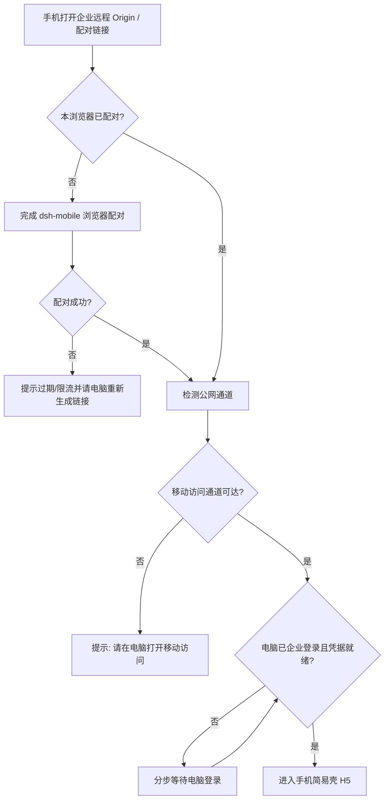

# 武汉地铁 · Desktop 移动访问与手机浏览器（H5）自动连接 PRD

| 字段 | 内容 |
|---|---|
| 版本 | mobile-access-enterprise-v1 |
| 日期 | 2026-11-12 |
| 修订 | 第 3 轮：对标 ChatGPT Codex Remote——账号同源、扫码绑主机、电脑管设备；一人一机钉死（不做最近登录漂移） |
| 关联 | 联调基线：公网 FRP `https://47.99.34.208`；壳层见 `mobile-go-shell-v1`；参考 [Codex Remote connections](https://learn.chatgpt.com/docs/remote-connections.md) |
| 读者 | 产品 / 交付 / Desktop / 前端 H5 / 运维 |
| 状态 | 已确认（浏览器/H5 · 学 Codex · 不做单独原型 · 验收用现网 dsh-mobile） |
| 确认摘要 | dsh-mobile 通道 + 浏览器/H5；**学 Codex：企业账号同源、电脑端开远程并出码、手机扫码/链接绑死本机、电脑「设备」统一管理**；设备名=企业用户；配对免手填名称；多数人一人一机 |

---

## 1. 结论前置

产品体验**对齐 ChatGPT Codex Remote**，通道仍用企业预置 **dsh-mobile + FRP**：

| Codex 做法 | 我们对应 |
|---|---|
| 电脑与手机同一账号体系 | 电脑先企业登录；手机跟随电脑会话（不单独开企业写权限） |
| 桌面 Connections → Control this Mac/PC → 出码 | Desktop「移动访问」打开 → 生成远程配对二维码/链接 |
| 手机扫码绑**这一台主机** | 浏览器打开配对链接，**钉死当前 Desktop** |
| 主机上管理已连接设备 | 电脑「设备」列表查看/撤销 |
| 主机需在线 | Desktop 在跑且移动访问就绪；休眠则不可连 |

员工用**手机浏览器（日后可 H5 嵌 App）**；首次绑一次，之后书签/主屏幕打开即连；设备名与**企业用户绑定**，配对免手填名称。多数人一人一机，**不做最近登录自动换机**。

本版不交付原生 App、不做单独原型；联调验收用现网 dsh-mobile。壳层见 `mobile-go-shell-v1`。

职能泳道：[flow_core_swimlane.html](../../../prototype/versions/mobile-access-enterprise-v1/pages/flow_core_swimlane.html)

---

## 2. 目标与非目标

| 类型 | 内容 |
|---|---|
| 目标 | 学 Codex：电脑出码绑主机、设备在电脑管；通道用 dsh-mobile+FRP；浏览器/H5 日常免扫；跟随电脑登录；一人一机钉死 |
| 非目标 | 本版上架原生 App；无绑定公网裸奔；手机独立企业写会话；员工自建 frps |

---

## 3. 需求与优先级

| 优先级 | 需求 | 验收口径 |
|---|---|---|
| P0 | Desktop「移动访问」开关 | 默认关；打开后企业 FRP 就绪；关闭后公网 discovery 失败或不可用 |
| P0 | 企业预置通道 | 安装包内嵌统一 frps / Origin；员工不可改生产 Token |
| P0 | 手机浏览器入口 | 使用 dsh-mobile 远程 HTTPS Origin；可用电脑「复制远程配对链接」完成首次绑定 |
| P0 | 日常免扫 | 绑定成功后，同一浏览器再次打开入口可自动重连（通道开着时） |
| P0 | 一人一机钉死（学 Codex） | 配对绑定**当前这台** Desktop；默认无多机点选、无「最近登录漂移」；换机=在新电脑再配对 |
| P0 | 设备名=用户绑定 | 列表展示名=企业用户显示名/账号；配对页隐藏或跳过「设备名称」 |
| P0 | 跟随电脑登录 | WaitGate 保留；电脑登录并选项目且凭据就绪后自动进 |
| P0 | 分步等待态 | 区分：检测通道 / 未绑定 / 等待电脑登录 / 进入；禁止长期无文案转圈 |
| P1 | 主屏幕 / 收藏指引 | 交付说明含「添加到主屏幕」或固定书签步骤（iOS Safari / 安卓 Chrome） |
| P1 | 设备管理 | 电脑可撤销设备；手机提示失效并引导重新打开配对链接 |
| P1 | H5 嵌 App 预留 | 页面在 WebView 可用；不依赖仅原生才有的能力；`User-Agent`/全屏按 WebView 验收 |
| P1 | 与简易壳衔接 | 进入后走 `mobile-go-shell-v1` |
| P2 | 企业 App 容器 | 用 WebView 加载同一 Origin（后续版本） |
| P2 | 域名备案入口 | 现阶段 IP；域名后续 |

---

## 4. 角色与职责

| 角色 | 职责 |
|---|---|
| 员工（手机浏览器/H5） | 首次打开配对链接；日常从书签/主屏幕进入 |
| 员工（电脑） | 企业登录、选项目；打开「移动访问」；需要时生成配对链接 |
| 交付/运维 | VPS frps+Caddy+证书；安全组；安装包预置 |
| 产品/研发 | Desktop 开关；等待态文案；H5/WebView 兼容 |

---

## 5. 业务流程

### 5.1 总览

**文字解读：** 绑定在浏览器侧完成；通道与电脑登录仍是两道独立门；未来 App 只是用 WebView 打开同一地址，流程不变。

### 5.2 正常流程

1. Desktop 登录企业并选项目 → 打开「移动访问」至就绪。
2. 电脑端生成/复制**远程配对链接**，手机浏览器打开并完成一次配对。
3. （建议）Safari/Chrome「添加到主屏幕」或收藏该 Origin。
4. 之后打开书签/图标 → 自动连 → 若电脑未登录则等待，登录后自动进壳。

### 5.3 边界情况

| 情况 | 行为 |
|---|---|
| Desktop 在跑未开移动访问 | 显示通道未开，不与「请登录」混淆 |
| 通道开、电脑未登录 | `waiting_pc_login`，约 3s 轮询，登录后自动进 |
| 清站点数据 / 换浏览器 | 需重新配对 |
| Safari 与主屏幕 Web App | 可能各需一次配对（按 dsh-mobile 既有行为） |
| 未来 App WebView | 加载同一 HTTPS Origin；首次仍可能要配对或迁移 Cookie/存储策略（P2 单独立项） |

### 5.4 异常兜底

| 异常 | 兜底 |
|---|---|
| 配对码过期 | 电脑重新生成链接 |
| 设备被撤销 | 手机 401/失效提示 → 重新配对 |
| 证书/续期失败 | 运维续期；手机提示证书问题 |
| WebView 拦截 Cookie | P2 容器版单独验收存储与第三方 Cookie |

---

## 6. 状态文案（P0）

| 阶段码 | 用户可见文案 |
|---|---|
| `checking_bind` | 正在确认本机授权… |
| `need_bind` | 请使用电脑提供的配对链接完成首次绑定 |
| `checking_tunnel` | 正在连接企业移动入口… |
| `tunnel_off` | 请在电脑打开「移动访问」后再试 |
| `waiting_pc_login` | 请先在电脑完成登录；登录并选择项目后将自动进入 |
| `waiting_pc_creds` | 电脑尚未就绪模型凭据，请在电脑重新登录后再试 |
| `entering` | 正在进入助手… |

---

## 7. 绑定与命名策略（本轮修订）

| 方式 | 优先级 | 说明 |
|---|---|---|
| dsh-mobile 远程配对链接 / 码 | **主路径（P0）** | 浏览器首次绑定；名称字段对用户隐藏或可跳过 |
| 设备展示名 | **P0** | 与企业登录用户绑定；电脑「设备」列表按人识别与撤销（同 Codex 在主机上管 connected devices） |
| 连接目标 | **P0** | **钉死配对时的那台主机**；主机需在线（同 Codex：电脑休眠则远程停） |
| 企业 App WebView | P2 | 容器加载同一 H5，不新开协议 |

### 7.1 统一管理口径（学 Codex）

| 管理面 | 职责 |
|---|---|
| 电脑「移动访问 / 设备」 | **唯一授权台账**：已配对手机、按用户名展示、撤销 |
| 手机浏览器 | 打开即连已绑主机；不维护多电脑列表 |
| 换电脑 | 新主机打开移动访问并重新配对；建议在旧主机撤销旧授权 |

---

## 8. 安全与约束

| 项 | 要求 |
|---|---|
| 信任 | 已配对浏览器配置 = 高信任遥控端 |
| 开关默认 | 关 |
| Token | 不进日志；配对链接当秘密 |
| 通道 | HTTPS 公开入口；frps 明文 vhost 仅回环 |
| H5 嵌 App | 仍须 HTTPS；不得降级明文打包骗过证书 |

---

## 9. 与现状映射

| 现状 | 本 PRD |
|---|---|
| FRP + discovery 已通 | 浏览器入口的通道基线 |
| dsh-mobile 浏览器配对 | **正式客户端路径** |
| cowatch WaitGate | 保留并分步文案 |
| mobile-go-shell-v1 | 进入后的壳 |
| 自研原生 App | **本版不做**；后续仅作 H5 容器可选 |

---

## 10. 风险项

| 风险 | 缓解 |
|---|---|
| 用户找不到入口 | 固定 Origin 说明 + 主屏幕指引 |
| 清缓存掉绑定 | 失效文案 + 一键说明如何重新配对 |
| 误以为要装 App | 交付物写明「浏览器即可」 |
| 日后 WebView Cookie 差异 | P2 单独立项验收 |

---

## 11. 验收清单

| # | 步骤 | 期望 |
|---|---|---|
| 1 | Desktop 移动访问默认 | 关 |
| 2 | 打开开关 | 就绪；discovery=200 |
| 3 | 手机浏览器打开远程配对链接 | 完成首次绑定并进入（或经登录等待） |
| 4 | 同浏览器再次打开 Origin | 免扫自动连 |
| 5 | 电脑退出登录 | 回等待登录；再登自动进 |
| 6 | 关闭移动访问 | 手机显示通道未开 |
| 7 | 桌面 UA | 无手机 WaitGate 误伤 |
| 8 | （P1）主屏幕图标冷启动 | 可进入或给出明确重配指引 |

---

## 12. 交付切片

| 切片 | 内容 | 优先级 |
|---|---|---|
| M1 | Desktop 开关 + 企业预置 FRP | P0 |
| M2 | 浏览器远程配对 + 日常重连 + 分步等待 | P0 |
| M3 | 主屏幕/收藏交付说明 | P1 |
| M4 | 设备撤销体验打磨 | P1 |
| M5 | 企业 App WebView 嵌同一 H5 | P2 |

---

## 【待确认】

| # | 项 | 本轮默认 | 若需推翻请明示 |
|---|---|---|---|
| 1 | 客户端形态 | 手机浏览器 / H5；不做原生 App | — |
| 2 | 后续进 App | 以 H5 WebView 嵌入，不另做协议 | 容器 App 名称/排期 |
| 3 | 首次绑定 | dsh-mobile 配对链接为主 | — |
| 4 | 正式 Origin | 联调 IP；上线前给最终值 | 请业务补域名或固定 IP |
| 5 | 连接策略 | **已定为钉死一机（学 Codex）** | — |
| 6 | 用户展示名字段 | 优先企业显示名，其次账号 | 与 identity 字段对齐时再定 |
