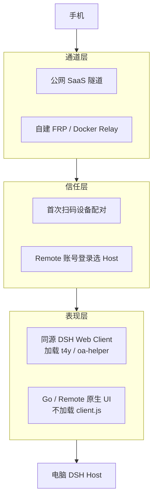
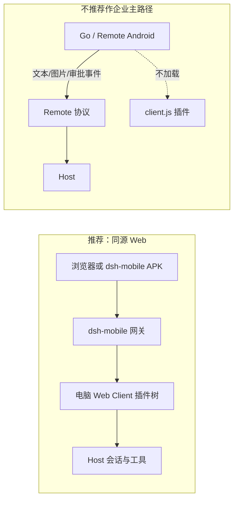
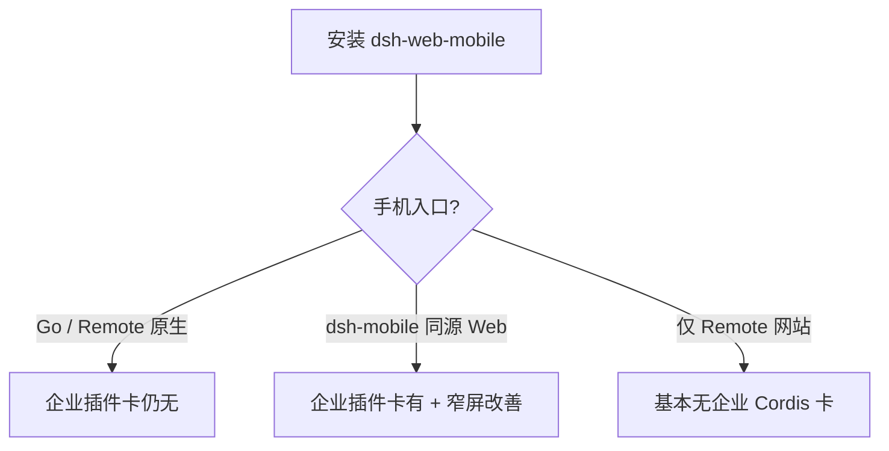

# 武汉地铁 · 手机端接入方案选型对比

| 字段 | 内容 |
|---|---|
| 版本 | v1.0 |
| 日期 | 2026-11-05 |
| 范围 | 手机遥控电脑端 DSH；本地企业插件（`t4y-*` / `oa-helper`）手机展示 |
| 读者 | 产品 / 交付 / 研发 |
| 结论状态 | 待拍板（见文末【待确认】） |

---

## 1. 结论前置

### 1.1 一句话结论

**企业插件要在手机上正常展示（请假卡、企业登录、授权 Hub 等），手机必须打开「与电脑同一套 Web Client」；不能走 DSH Go / Remote 原生对话壳。**

推荐主路径：

| 优先级 | 组合 | 作用 |
|---|---|---|
| P0 | **dsh-mobile**（同源网关 + 浏览器 / 官方 APK） | 外网通道、首次扫码配对、加载全部 Cordis Client 插件 |
| P0 | **dsh-web-mobile**（叠在上述 Web 上） | 窄屏布局，少自研改 AppFrame |
| P1 | **t4y-identity 企业网关 / host-session** | 电脑已登录后手机减少企业再登摩擦 |
| P2 | Go + Remote | 仅作「纯文本应急遥控」，**不进企业插件交付范围** |

### 1.2 与既往体验的对齐

| 现象 | 原因定性 |
|---|---|
| Go + Remote 只能传文本、插件不显示 | **架构必然**：原生壳不加载电脑 Web 的 `client.js` |
| dsh-mobile 改多轮仍不顺 | **非「带不动插件」**：更像布局 / 登录叠层 / 企业 API / WS 放行 / 与 cowatch 冲突 |
| 以为 web-mobile + Remote 能救展示 | **概念错位**：web-mobile 只改 Web Client，Remote 原生壳不执行它 |

---

## 2. 需求与优先级

| 优先级 | 诉求 | 验收口径 |
|---|---|---|
| P0 | 手机操控电脑端 | 会话、工具、审批在 **PC Host** 执行 |
| P0 | 本地插件手机可展示 | `oa-helper` 请假卡、`t4y-identity` 登录壳、`t4y-capability-hub` 等可见可用 |
| P0 | 外网可用 | 手机 4G / 异地可连；自建或公网均可；优先现成项目 / Docker |
| P0 | 客户端形态 | **手机浏览器必做**；**APK 最好有** |
| P0 | 登录摩擦 | 接受 **首次扫一次**，之后自动连；不要求每天扫码 |
| P1 | 二次开发简单 | 继续写 Cordis `client.js`，不强制 Flutter/Remote 原生卡双端 |
| P2 | 手机独立完整能力 | 本机跑引擎等；非主加分项 |
| — | Remote 公网中继 | **不否决**，但不作为企业插件主 UI |

---

## 3. 架构分层（读懂所有方案）

**文字解读：**

- **通道层**决定能不能出外网。
- **信任层**决定扫不扫码、登不登录。
- **表现层**决定本地插件能不能显示——这是武汉地铁的关键约束。

本地插件全部挂在 Web Client：

| 插件 | Client 注入点（摘要） | 离开 Web Client 的结果 |
|---|---|---|
| `oa-helper` | `conversation.chat.commandview` / `turnTail` / `input.dock` | 请假表单卡消失，只剩文本 |
| `t4y-identity` | `shell.overlay` 登录 / 选项目 | 企业登录壳不出现 |
| `t4y-capability-hub` | `conversation.input.left` / `settings.section` | 授权与快捷轨缺失 |
| `t4y-brand` | `sidebar.brand.*` / hero brand | 品牌回退默认 |
| `t4y-mobile-cowatch` | 手机 UA WaitGate 等 | 可能与 dsh-mobile 登录门叠床架屋 |

---

## 4. 方案逐项对比

### 4.1 方案 A：dsh-mobile（社区移动访问）

| 维度 | 评估 |
|---|---|
| 本质 | 电脑装插件；手机浏览器 / 官方 Android WebView App 经 LAN 或远程隧道打开 **同一套 Web** |
| 遥控电脑 | 强 |
| 本地插件展示 | **强（结构性）** |
| 外网 | Tailscale Funnel / cpolar / cloudflared / 自建 FRP / 自有反代 / 托管 Caddy 等 |
| 现成工程 | FRP 有模板与一键部署；隧道组件由插件拉官方二进制；**无单一 dsh-mobile Server Docker** |
| 浏览器 | 支持 |
| APK | 官方 App（与插件独立版本号） |
| 首次扫一次 | 支持；临时域名变更时可能再扫一次验证新 Origin |
| 二次开发 | 继续 Cordis；第三方 WS 默认拦截，需诊断页按精确路径放行 |
| 与既往失败 | 失败应排查布局 / 登录叠层 / 企业 API / WS，而不是换 Remote |

**正常流程：** 电脑开远程 → 首次扫远程二维码 → 之后 App/浏览器自动连 → 看到与电脑相同的企业 UI。

**边界情况：** cpolar/quick tunnel 地址变化 → 再扫一次；插件自定义 WS 被拦 → 诊断放行。

**异常兜底：** 手机丢失 → 电脑撤销设备；通道断 → 用诊断面板，不降级成「手机本地假登录」。

---

### 4.2 方案 B：dsh-Go + ds-harness-remote

| 维度 | 评估 |
|---|---|
| 本质 | Host 装 Remote；手机用 Go / Remote Android / Remote Web 连 Host |
| 遥控电脑 | 强（事件层） |
| 本地插件展示 | **弱（结构性）** |
| 外网 | 强；Host 只出站；LAN→P2P→TURN→Relay |
| 现成工程 | **高**：`apps/server` 支持 `docker compose`；另有公网 `dsh.r2049.cn` |
| 浏览器 | Remote Web 有；**不等于**电脑 profile 的 client 插件树 |
| APK | Go APK + Remote 官方 Android |
| 首次扫一次 | 更偏账号登录 + 选 Host；设备凭据可持久 |
| 二次开发 | 需按 Go/Remote 原生卡重做；成本高 |

**官方口径（Go 文档）：** 经 DSH Remote 连接时：只能发送图片；App 内打不开网页版；插件只能开关；DS Bot 与导出对话日志不可用。

**正常流程：** 能聊、能批、能看文本进度。

**边界情况：** 另一台已装全插件的 Desktop 通过 Remote「复用本机界面」时，**那台电脑**仍能看到插件；手机 Go 看不到。

**异常兜底：** 手机看不到请假卡 → **预期行为**，不要继续在 Go 里调企业 Cordis 展示。

---

### 4.3 方案 C：dsh-web-mobile

| 维度 | 评估 |
|---|---|
| 本质 | **仅** DSH Web UI 窄屏适配（抽屉、bottom sheet、安全区、压缩大 JSON 等） |
| 遥控 / 外网 | **不提供**；必须另配通道 |
| 本地插件展示 | 不负责加载；把已加载的 Web 插件变得更好用 |
| 与 t4y / oa-helper | 兼容取向好；桌面键鼠窗口 no-op |
| APK | 无；可被 dsh-mobile App / DSHA 等壳打开同一 Web |

**定位：** UI 层积木，不是完整产品方案。

---

### 4.4 方案 D：仅 t4y-mobile-cowatch（现状会话层）

| 维度 | 评估 |
|---|---|
| 本质 | 手机 UA 继承电脑 `host-session`；不单独企业登录 |
| 插件展示 | 同源 Web 理论可显示 |
| 外网 / APK / 配对 | 缺；需外部穿透 |
| 风险 | 与 dsh-mobile 双登录门、自研布局易伤桌面 |

**定位：** 会话摩擦优化积木；不能单独立项做外网产品。

---

### 4.5 方案 E：轻量 LAN 门闸（cindy / lan-gate 类）

| 维度 | 评估 |
|---|---|
| 插件展示 | 同源 Web → 好 |
| 外网 | 弱，需再叠隧道 |
| APK | 一般无专用包 |
| 首次信任 | 部分方案有审批 / 长期 Token |

**定位：** 可信内网试点；外网主路径不如 A。

---

### 4.6 方案 F：企业组合（推荐落地形态）

| 层 | 选型 | 说明 |
|---|---|---|
| 表现 | 电脑 Web Client（全部 `t4y-*` / `oa-helper`） | 插件零重写 |
| 通道 + 信任 | **dsh-mobile** | 外网 + 首次扫一次 + 浏览器/APK |
| UI | **dsh-web-mobile** | 替代大量自研窄屏改写 |
| 会话 | identity 企业网关 + 可选弱化 cowatch | 电脑登录后手机少摩擦 |
| 明确不做 | Go/Remote 原生壳展示企业卡 | 避免无效投入 |

---

### 4.7 附：DSHA

手机本机跑完整 DSH（内置 web-mobile 快照）。主故事是「手机当 Host」，不是「遥控公司电脑」，与 P0 错位；仅作 P2 参考。

---

## 5. 专项：web-mobile 能否与 Remote 一起用？

| 场景 | 能否同装/同用 | 手机上企业插件卡？ |
|---|---|---|
| 电脑 web profile 同时装 `dsh-web-mobile` + `ds-harness-remote` | 通常可以（未见二者硬互斥） | 与手机原生 Remote **无关** |
| 手机 Go / Remote Android **原生 UI** | web-mobile **不执行** | **仍无** |
| 手机经 **dsh-mobile** 打开电脑 Web，且已装 web-mobile | **有效组合** | **有**，且窄屏更好 |
| 手机打开 `dsh.r2049.cn` Remote Web | Remote 站点能力集 ≠ 电脑 profile 插件树 | **多数 Cordis 企业卡仍无** |

**结论：** web-mobile + Remote ≠ 手机 Remote 壳变出请假卡；web-mobile + dsh-mobile 才对。

---

## 6. 总对比矩阵

| 维度 | A dsh-mobile | B Go+Remote | C web-mobile | D 仅 cowatch | E 门闸 | F 企业组合 |
|---|---|---|---|---|---|---|
| 外网 | ★★★★★ | ★★★★★ | ★☆☆☆☆ | ★☆☆☆☆ | ★★☆☆☆ | ★★★★★ |
| 现成 Docker/项目 | ★★★★☆ | ★★★★★ | ★☆☆☆☆ | ★☆☆☆☆ | ★★☆☆☆ | ★★★★☆（借 A/B） |
| 浏览器 | ★★★★★ | ★★★★☆ | ★★★★★ | ★★★☆☆ | ★★★★★ | ★★★★★ |
| APK | ★★★★★ | ★★★★★ | ★★☆☆☆ | ★☆☆☆☆ | ★☆☆☆☆ | ★★★★☆ |
| 首次扫一次 | ★★★★★ | ★★★☆☆ | — | ★★★★☆* | ★★★★☆ | ★★★★★ |
| 遥控电脑 | ★★★★★ | ★★★★★ | — | ★★★★☆ | ★★★★★ | ★★★★★ |
| **本地插件展示** | ★★★★★ | ★☆☆☆☆ | ★★★★☆** | ★★★★☆ | ★★★★★ | ★★★★★ |
| 二次开发 | ★★★★☆ | ★☆☆☆☆ | ★★★★★ | ★★★★★ | ★★★★★ | ★★★★★ |

\* 免扫码但缺外网与设备身份  \*\* 只改善 UI，不提供通道与加载

---

## 7. 工作量粗估（相对人天，供排期）

| 方案 | 外网 MVP | 企业插件可用 | 说明 |
|---|---|---|---|
| A | 1～3 | 3～8 | 装插件 + 选通道 + 配对；再验 t4y / WS / 登录 |
| B | 0.5～2 | 10～30+ | 通道快；插件重做贵 |
| C | — | 1～3 | 叠在已有同源 Web 上 |
| D | 5～15 | 已有会话能力 | 自建穿透 + UI + APK |
| F | 3～10 | 5～12 | A + C + 会话对齐；收缩 cowatch 布局 |

---

## 8. 风险项

| 风险 | 等级 | 说明 | 缓解 |
|---|---|---|---|
| 继续押宝 Go 做企业 UI | 高 | 与 Cordis Client 架构冲突 | 退出主路径 |
| 误以为 web-mobile+Remote 能救展示 | 高 | 壳不同 | 文档宣贯；主路径写死同源 Web |
| dsh-mobile + cowatch 双门 | 高 | 易登录死循环 / 改多轮失败 | 收缩 cowatch；统一登录时序 |
| 公网直连企业内网 API | 高 | 手机达不成 Broker | 强制 Host `/api/t4y-enterprise/*` 代理 |
| 第三方 WS 未放行 | 中 | 插件半残 | dsh-mobile 诊断精确放行 |
| 免费隧道不稳/限速 | 中 | cpolar 免费档等 | 命名隧道或自建 FRP |
| APK 内发/签名合规 | 中 | 官方包 vs 自有品牌壳 | 首期可用官方 App；品牌壳单列 |

---

## 9. 建议决策与落地顺序

| 次序 | 动作 | 优先级 |
|---|---|---|
| 1 | 锁定主路径：**dsh-mobile 同源 Web**（浏览器 + 官方 APK） | P0 |
| 2 | 叠装 **dsh-web-mobile**；停止大规模自研 AppFrame/抽屉改写 | P0 |
| 3 | 梳理登录时序：identity ↔ dsh-mobile ↔（可选）cowatch；避免双 WaitGate | P0 |
| 4 | 出兼容探针：Client 是否加载、请假卡是否注册、企业 proxy、WS 放行 | P1 |
| 5 | Go+Remote 标为「文本应急」，不进企业验收用例 | P1 |
| 6 | 远期再评估自有 APK 壳 / 私有 Remote Server（仅通道） | P2 |

---

## 10. 参考来源（公开口径）

| 项目 | 说明 |
|---|---|
| [saya-ch/dsh-mobile](https://github.com/saya-ch/dsh-mobile) | 同源 Web、配对、远程通道、第三方插件与 WS 放行说明 |
| [ccch1mneyyy/dsh-Go](https://github.com/ccch1mneyyy/dsh-Go) `docs/guide/zh/03-engine-hosts.md` | Remote 下附件/网页版/插件能力限制 |
| [liguobao/ds-harness-remote](https://github.com/liguobao/ds-harness-remote) | Remote 协议、Docker Server、客户端形态 |
| [mexiaosqwq/dsh-web-mobile](https://github.com/mexiaosqwq/dsh-web-mobile) | 仅 Web 窄屏适配；`MOBILE_QUERY` 激活条件 |
| 本仓库 `tsy-custom-plugins/*` | 本地插件均为 `__ModuleLoader__` + slots / uiConversation |

---

## 【待确认】

1. 是否正式接受：**企业插件手机展示只走同源 Web（dsh-mobile ± web-mobile），Go+Remote 退出主路径？**
2. dsh-mobile 历史失败更接近：**(a) 进不去/白屏 (b) 能进无请假卡 (c) 有卡布局乱 (d) 登录死循环**？（可多选）
3. APK 首期是否接受 **dsh-mobile 官方包内发**，还是必须 **自有包名/品牌壳**？
4. 外网首试点通道更倾向：**cloudflared 命名隧道 / 自建 FRP / cpolar / Remote 仅作备用文本**？
5. 下一步交付物选哪项：**(A) 兼容探针清单并本机跑一轮 (B) 卸/弱化 cowatch、改叠 web-mobile 的改造说明 (C) 本文压缩成一页汇报版**？

---

*文档路径：`tsy-custom-plugins/手机端接入方案选型对比.md`*
